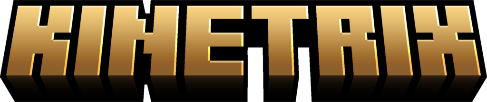

# Kinetrix (Forge 1.20.1) — beta



Автор: **Inclyae**. Раньше мод назывался MC Reload Animations.

**Зависимости:** нужен [Player Animator](https://modrinth.com/mod/playeranimator) (KosmX) для Forge 1.20.1. Необязательно, подхватываются сами: Better Combat, Iron's Spells 'n Spellbooks и любые моды на playerAnimator. bendy-lib не нужен: Kinetrix сам рисует сгибы.

Процедурные анимации игрока в духе Mo' Bends на **playerAnimator**. Работает самостоятельно,
а с **Better Combat**, **Iron's Spells 'n Spellbooks** и **Emotecraft** плавно смешивается: без
рывков, без резких переключений и без конфликтов ног, головы и туловища.

## Что анимируется

Мод **полностью заменяет** ванильную позу своими циклами, как Mo' Bends. Руки и ноги сгибаются в
локтях и коленях на настоящих шарнирах, корпус гнётся в поясе (голова и руки идут вместе с ним),
броня и предмет в руке сгибаются тоже. Для этого не нужен bendy-lib: суставы рисует сам мод (если
bendy-lib установлен, мод уступает ему). Основные циклы (стойка, ходьба, бег, присед, бой) сделаны
по мотивам Mo' Bends (MIT). Все части тела, кроме головы, движутся на пружинах: с инерцией, перелётом и «тряпичной» волной, как в Fresh Animations. Сила этого эффекта задаётся параметром `general.liveliness`.

| Ситуация | Анимация |
|---|---|
| Стойка | Расслабленная: вес на одной ноге, носки врозь, мягкие колени и локти, руки чуть в стороны, дыхание |
| Ходьба | Как в Mo' Bends: колено маховой ноги сгибается, плечи в противофазу бёдрам, корпус покачивается |
| Спринт | Наклон вперёд, длинные шаги с работой коленей, сильный поворот плеч, локти работают, корпус пружинит, голова смотрит вперёд. С мечом в руке: меч держит как обычно, машет свободной рукой |
| Торможение | Только после спринта, коротко: корпус по инерции уходит чуть вперёд, передняя нога упирается, тело отклоняется назад для равновесия |
| Присед | Как в Mo' Bends: корпус наклонён вперёд и покачивается, шаги с поочерёдным сгибом коленей, руки чуть вперёд и в стороны. Быстрое нажатие Shift больше не разрывает модель |
| Прыжок | С разбега ведущая нога чередуется. На месте: колени подтягиваются, ноги чуть в стороны. Падение назад с S с высоты (с уступа, обрыва — не обычный прыжок): откидывается на спину, руки за головой, головой к земле; кувырок назад в момент касания |
| Падение | Руки подняты буквой Y, ноги болтаются. При затяжном падении поза парашютиста |
| Приземление | Ноги «уходят в тело» и пружинят. Высокое с зажатой W: короткий кувырок вперёд, с S (лёжа на спине): кувырок назад, без них: глубокий присед. С мечом (в том числе со щитом или тотемом во второй руке) без W — ни одной клавиши, A, S или D: в полёте меч двумя руками перед лицом остриём вниз, при касании садится на колено и быстро вбивает меч в землю перед коленом (0.8 с); с зажатой W — обычное падение и кувырок вперёд. С элитр: мягкая посадка поглощается, жёсткая (врезался на скорости) — кувырок с W или глубокий присед. При слезании с лошади без кувырка |
| Элитры | Руки отведены назад вдоль тела, ноги вместе, всё дрожит в потоке |
| Плавание | Со спринтом: кроль. Выход из воды на сушу плавный (ванилла дёргала тело и голову). Без спринта (только на глубине): держится вертикально, плечи над водой, ноги «взбивалкой», руки гребут восьмёркой. На мелководье обычная ходьба, без мигания поз. Прыжок в воду с суши с высоты от ~1.5 блока: «дельфинчик» начинается с верхней точки прыжка и длится до входа в воду головой вниз. Падение спиной в воду с зажатой S: лежит на спине, руки за головой |
| Лестница | Плавно перебирает: руки вверх-вниз по очереди, ноги шагают по ступеням под собой |
| Меч | Удары одной рукой из плеча с коротким замахом и плавным разгоном и торможением, корпус поворачивается в удар, клинок в конце удара выстраивается по руке и не проходит сквозь тело. Серия: горизонтальный, восходящий, сверху, **с разворота**. После боя несколько секунд стоит в низкой стойке боком; просто с мечом в руке ходит и стоит как обычно. Белый шлейф |
| Топор | Тяжёлые удары одной рукой: сверху и горизонтальный, всем корпусом |
| Кулаки | Боксёрская стойка: кулаки перед грудью на расстоянии, локти согнуты ~50°, руки не прижаты к телу. Удары поочерёдно. Копает руками поочерёдно; если во второй руке щит или тотем — только свободной |
| Прочие предметы | Блок, броня, еда, деталь из мода и всё, что не оружие и не инструмент: удар по воздуху или по мобу — короткий замах у головы и хлёсткий удар туда, куда смотришь, с корпусом (раньше был ванильный взмах рукой). По блоку — удар одной рукой |
| Блоки | Установка блока (и любой ПКМ по блоку): рука вдавливает его на место |
| Инструменты | Одной рукой (вторая спокойно висит): кирка стучит, лопата поддевает, мотыга рубит, топор по дереву бьёт с плеча. Блоком или другим предметом по блоку — тоже удар одной рукой |
| Выброс (Q) | Заметный бросок от себя с замахом, поочерёдно каждой рукой |
| Лук | Руки целятся ровно туда же, куда ванилла (по камере), рука с луком прямая. Тянущая рука всё время рядом с луком и чуть оттягивает тетиву назад (локоть сгибается вбок, а не вверх). Грудь и плечи поворачиваются вслед за взглядом, поэтому руки не проходят сквозь тело при повороте камеры. Стойка лучника ногами. Выстрелы чередуются: классический и с горизонтальным луком |
| Арбалет | Держит двумя руками у тела, как дробовик, неподвижно (руки не болтаются при ходьбе и беге): рука на прикладе у бедра, вторая спереди под ложем, плечи развёрнуты. Заряженный — чуть выше и ровнее, ноги в стойке. При зарядке тянет тетиву рукой |
| Щит | Полуприсед за щитом, ноги продолжают шагать; стоя — разнесённая стойка. Щит всегда стоит вертикально перед грудью, в том числе на Shift. Отдача при каждом заблокированном ударе |
| Еда и питьё | Ко рту подносится сама еда, а не кулак: рука останавливается под подбородком, голова кивает при жевании |
| Трезубец | Бросок как копьё: рука отведена высоко за плечо, корпус боком, свободная рука указывает на цель, широкий шаг; при броске хлёст через верх с переносом веса вперёд. Удар трезубцем — выпад-укол вперёд |
| Удочка | Заброс: удочка за плечо и резкий взмах вперёд с шагом. Ожидание: удочка вверх, вес на задней ноге, кончик иногда дёргается. Подсечка: резкий рывок вверх-назад |
| Урон | Удар спереди: отбрасывает назад, руки вперёд. Удар сзади: толкает вперёд, руки назад |
| Взрыв | Закрывается руками, как от светошумовой гранаты. С мечом: отбрасывает назад с поднятыми руками, затем низко приседает, втыкает меч в землю сбоку, опирается второй рукой о землю и проезжает назад, после чего встаёт |
| Тотем | Растерянно разглядывает свои руки |
| Смена рук (F) | Руки сходятся к середине и расходятся |
| Безделье | Примерно раз в 10 с без дела, только аккуратные движения, при которых руки не проходят сквозь тело: потягивается, оглядывается, разминает шею, пинает камешек. С предметом в руке играет с ним: меч крутит в пальцах, осматривает, проводя второй рукой по клинку, делает пробные взмахи; топор осматривает и кладёт на плечо; кирку кладёт на плечо; на лопату/мотыгу/трезубец опирается; огнивом щёлкает; в ведро заглядывает; удочку проверяет; фонарь поднимает; блок разглядывает. Отключается `modules.idleActions` |
| Ползание (C, пока клавиша зажата) | Отдельная анимация, не как плавание: ползёт по-пластунски, как в пещере. Предплечье выбрасывается вперёд и упирается, тело подтягивается к нему, локоть уходит в сторону; противоположное колено подтянуто вбок «лягушкой» и толкает. Бёдра чуть перекатываются, голова поднята и смотрит вперёд. Лёжа на месте — опирается на предплечья, ладони рядом с головой. Руки и ноги не заходят друг в друга, в грудь и в лицо (цикл проверен на модели). Пролезает в проёмы высотой в 1 блок (как в Personality). Ползёт, пока C зажата; отпустил — встал (под низким потолком игра оставит ползком, пока не будет места). Колено подтягивается мягко, бедро не отходит от таза. Та же анимация, когда игру саму кладёт ползком (под люком) |
| Сидение (X) | Садится на землю и время от времени меняет позу: откинулся назад на руки (ладони на земле позади) с одним коленом вверх; одно колено вверх с рукой на нём, вторая нога подогнута, ладонь на земле. Таз на земле, ноги и руки не входят в тело (позы проверены на модели). Хитбокс и камера опускаются. Встать — X ещё раз, любое движение, прыжок или Shift |
| Эмоции (B) | Меню эмоций: Default dance (3 части), флосс, раннинг мэн, робот, воздушная гитара, покрасоваться, медитация (парит, скрестив ноги), помахать, хлопать, фейспалм, пожать плечами, отдать честь, поклон, сесть, «класс», победа, указать, смеяться, плакать, отжимания. Любое движение прерывает. Видны только тебе |
| Физика | Руки, корпус и ноги свободно отстают и раскачиваются при разгоне, остановке, повороте и приземлении |
| Сон | Раскинулся звездой, над головой поднимаются «Z z z» |
| Езда | Лодка: гребля вёслами. Вагонетка: руки на бортах, трясёт на стыках, наклоняет на поворотах и при разгоне/торможении, на полной скорости руки вверх. Стоя в лодке или вагонетке — каждые ~5 с другое занятие: откинулся с руками за головой, оглядывается, потягивается, свесился за борт (из лодки — рука в воде), барабанит пальцами. Лошадь: шаг, рысь, галоп в жокейской посадке, прыжки, дыбы, похлопывание по шее. Большие широкие лошади (DragN's Livestock Overhaul и всё из `compat.wideMounts`): посадка ниже, ноги вперёд и чуть шире, чем у ванильной лошади, руки держат поводья низко перед собой, разведены, локти согнуты. Свинья и лавомерка — как лошадь, удочка с приманкой вытянута вперёд |
| Iron's Spells | Стойка мага по школе магии, отдача при завершении каста |

## Как устроена совместимость

Мод добавляет в стек playerAnimator каждого игрока два слоя:

1. **Базовый слой** в самом низу стека. Он добавляет наши движения поверх ванильной позы, а все
   анимации других модов играют поверх него.
2. **Гармонизатор** в самом верху стека. Каждый кадр он сравнивает итоговую позу с нашей и
   поэтому видит, какой частью тела сейчас управляет другой мод: Better Combat, Iron's,
   эмоции. Дальше он делает три вещи:
   - **кроссфейдит** каждую часть тела, когда чужая анимация начинается или заканчивается, и рывков больше нет;
   - **уступает**: наши движения рук, корпуса и головы затихают, пока ими управляет другой мод, и конфликта нет;
   - **сохраняет бег ног**: если ты атакуешь или кастуешь на ходу, ноги продолжают бежать, а не замирают в стойке.

Better Combat и Iron's не нужны ни для сборки, ни для запуска. Iron's читается через
рефлексию, а Better Combat определяется гармонизатором автоматически, как и любой другой мод на
playerAnimator.

**Приоритет.** Ванильные действия (ходьба, бег, присед, прыжки, инструменты, безделье) — за
Kinetrix. Моды на playerAnimator, которые только заменяют ванильные анимации (список
`compat.priorityOverMods`, по умолчанию Vintage Animations), заглушаются. Боевые и магические
анимации (Better Combat и ресурспаки к нему вроде Malfu Combat Animation, Iron's Spells) играют
поверх, кроме моментов, когда идёт наше движение всем телом: эмоция, кувырок, приземление с мечом.

**Мобы.** Kinetrix анимирует только игроков. Мобов он не трогает: они остаются ванильными или
с анимациями Fresh Animations.

**Entity Model Features / Fresh Animations / Fresh Moves.** EMF подменяет модели своими и
анимирует их уже во время отрисовки, поверх всех. На игроке это давало «50 на 50»: половина
движений от Kinetrix, половина от Fresh Moves. Поэтому Kinetrix не даёт EMF подменить модель
игрока и его брони (`compat.playerOverEmf`, вкл. по умолчанию; действует после F3+T). Работает с
любой версией EMF 2.x и новее, в том числе со старыми 2.2.x из сборок. Мобы остаются с моделями и
анимациями Fresh Animations. Если какая-то модель всё же собрана из чужих деталей, суставы на ней не
режутся — она остаётся целой, а броня видимой.

**Шейдеры (Oculus), Embeddium, Xenon.** Суставы рисует сама модель игрока: согнутая рука или нога
выводится двумя половинами прямо при отрисовке модели, а детали модели не меняются. Раньше Oculus
(точнее, его ускоренная отрисовка моделей) не видел добавленные половины, и с шейдерами тело
становилось невидимым — оставались только голова и 3D-слой скина. Теперь тело и броня видны с
шейдерами и без них.

**Skin Layers 3D.** Объёмный внешний слой скина гнётся в локтях, коленях и поясе вместе с телом
(`compat.bendSkinLayers`).

**DragN's Livestock Overhaul.** Его лошади, ослы и мулы шире и выше ванильных. Для таких лошадей
(`compat.wideMounts`, по умолчанию `dragnlivestock`) Kinetrix садит всадника ниже, ставит ноги
вперёд чуть шире, чем на ванильной лошади, а руки держат поводья низко перед собой: разведены,
локти согнуты. Другие моды с крупными лошадьми можно добавить в список (id мода или id сущности).

**ParCool.** Свои паркур-движения (вольты, бег по стенам, кувырки, уклонения, подкаты, зацеп за
уступ, быстрый бег) ParCool анимирует сам. Пока он проигрывает такое движение, Kinetrix плавно
уступает этому игроку целиком и возвращается, когда движение закончилось. Если ParCool пропускает
расчёт позы модели, суставы не остаются согнутыми от предыдущего кадра или другого игрока.
Падение «руки в стороны» у ParCool можно выключить в его настройках, тогда в падении играет Kinetrix.

**Мультиплеер.** Анимации других игроков считаются у тебя из того, что показывает игра. То, что
знает только клиент игрока (зажатые клавиши, бьёт он блок или моба, выбранная эмоция,
idle-действие, кувырок, как он сидит), передаётся через сервер, если Kinetrix стоит на сервере или у хоста
LAN-мира. Без этого всё работает как раньше, просто эмоции видны только тебе
(`compat.syncWithOtherPlayers`).

## Установка

Нужны **Forge 1.20.1 (47.x)** и **[playerAnimator](https://modrinth.com/mod/playeranimator)** для Forge 1.20.1.
Better Combat и Iron's Spells необязательны.

Мод клиентский: на сервер его ставить не обязательно. Если поставить его на сервер (или он
стоит у того, кто открыл мир по LAN), игроки с Kinetrix видят эмоции, кувырки и действия друг
друга. Игроки без мода могут заходить на такой сервер как обычно.

## Настройки

Файл `config/kinetrix-client.toml`. Клавиши в «Управление → Kinetrix»: включение/выключение
(по умолчанию не назначена), меню эмоций (B), ползти (C, пока зажата), сесть (X). Если установлен Personality,
у которого те же C и X, наши клавиши ползания и сидения по умолчанию не назначены, а его ползание и
сидение получают анимации Kinetrix.

Ползание должно поддерживаться сервером, поэтому работает в одиночной игре, в LAN-мире у всех, если
Kinetrix стоит у хоста, и на сервере с Kinetrix. Сидеть можно везде, но хитбокс и камера опускаются,
а другие игроки видят, что ты сидишь, только когда Kinetrix есть на сервере.

- `general.intensity`: общая сила анимаций, от 0 до 2.
- `modules.*`: каждый модуль можно выключить отдельно.
- `modules.idleActions`: анимации безделья.
- `modules.postures`: анимации ползания и сидения.
- `controls.toggleSit`: X работает как переключатель (по умолчанию) или пока клавиша зажата. Ползание всегда только пока C зажата.
- `modules.twoHandedSwords`: держать меч двумя руками, когда вторая рука пустая (по умолчанию выкл.).
- `trails.*`: след клинка (вкл/выкл, `lifetimeSeconds`, `opacity`, `color` в формате RRGGBB).
- `compat.fadeInSeconds` / `fadeOutSeconds`: длительность перехода в чужую анимацию и обратно.
- `compat.yieldStrength`: насколько сильно наши руки и корпус уступают другим модам.
- `compat.keepLegsWhileMoving`: сохранять ли наш бег ног во время атак и кастов на ходу.
- `compat.ownMovesFirst`: во время эмоции, кувырка или приземления чужие анимации ждут.
- `compat.priorityOverMods`: моды (id или неймспейс анимаций), которые Kinetrix всегда перекрывает.
- `compat.playerOverEmf`: оставить игроку ванильную модель при Entity Model Features (Fresh Moves).
- `compat.bendSkinLayers`: сгибать 3D-слой Skin Layers 3D.
- `compat.syncWithOtherPlayers`: синхронизация с другими игроками по сети.
- `compat.wideMounts`: большие широкие лошади (id мода или сущности) — посадка ниже, ноги чуть шире, руки низко на поводьях. По умолчанию `dragnlivestock`.
- `debug.invertKnees` / `invertElbows` / `invertTorsoBend`: если какой-то изгиб идёт не в ту сторону.

## Сборка

```
./gradlew build
```
Готовый jar лежит в `build/libs/`. Нужен JDK 17. GitHub Actions собирает мод автоматически при каждом пуше.
